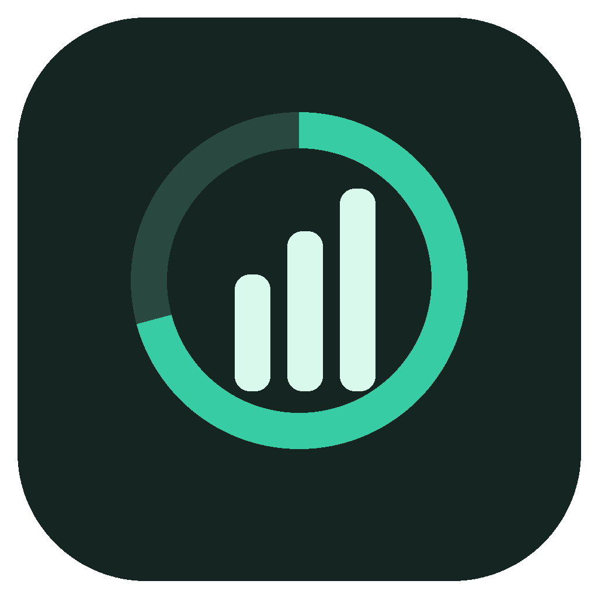

# Codex Quota Overlay

一个只在 Codex 位于前台时出现的小型桌面用量浮层，支持 **macOS 和 Windows**。查看剩余额度、周期重置倒计时、重置机会及到期时间、额外额度、订阅日期；需要时，在确认后使用指定的一次重置机会。

## 下载

<!-- downloads:start -->

| 你的系统                  | 最新稳定版 | 推荐下载                                                                                                                                     | 其他格式                                                                                                                                        | 更新说明                                                                                            |
| ------------------------- | ---------- | -------------------------------------------------------------------------------------------------------------------------------------------- | ----------------------------------------------------------------------------------------------------------------------------------------------- | --------------------------------------------------------------------------------------------------- |
| Windows 10/11 · x64       | **2.0.1**  | [下载安装版](https://github.com/aiximi/codex-quota-overlay/releases/download/windows-v2.0.1/Codex-Quota-Overlay-2.0.1-windows-x64-setup.exe) | [便携版 EXE](https://github.com/aiximi/codex-quota-overlay/releases/download/windows-v2.0.1/Codex-Quota-Overlay-2.0.1-windows-x64-portable.exe) | [查看变化](https://github.com/aiximi/codex-quota-overlay/blob/main/docs/releases/windows-v2.0.1.md) |
| macOS 13+ · Apple Silicon | **2.0.0**  | [下载安装版 DMG](https://github.com/aiximi/codex-quota-overlay/releases/download/v2.0.0/Codex-Quota-Overlay-2.0.0-mac-arm64.dmg)             | [压缩包 ZIP](https://github.com/aiximi/codex-quota-overlay/releases/download/v2.0.0/Codex-Quota-Overlay-2.0.0-mac-arm64.zip)                    | [查看变化](https://github.com/aiximi/codex-quota-overlay/blob/main/docs/releases/v2.0.0.md)         |
| macOS 13+ · Intel         | **2.0.0**  | [下载安装版 DMG](https://github.com/aiximi/codex-quota-overlay/releases/download/v2.0.0/Codex-Quota-Overlay-2.0.0-mac-x64.dmg)               | [压缩包 ZIP](https://github.com/aiximi/codex-quota-overlay/releases/download/v2.0.0/Codex-Quota-Overlay-2.0.0-mac-x64.zip)                      | [查看变化](https://github.com/aiximi/codex-quota-overlay/blob/main/docs/releases/v2.0.0.md)         |

<!-- downloads:end -->

[下载中心：各系统最新与历史安装包](DOWNLOADS.md) · [版本历史与每次变化](docs/VERSIONS.md) · [安装与使用](docs/USAGE.md)

[English](README.en.md) · [开发与 IDEA](docs/DEVELOPMENT.md) · [自动同步](docs/SYNC.md)

**这是独立的社区开源项目，与 OpenAI 没有官方关联。** 它不修改 Codex 安装文件，也不向聊天界面注入代码。




上图使用示例数据，不含真实账号信息。

## 功能

- 收起时为 `276 × 42` 小胶囊，点击展开；左侧拖动柄可以调整位置。
- 跟随前台 Codex 窗口；切换到其他应用或最小化 Codex 时隐藏。
- 显示官方返回的额度周期，而非假定所有账号都有 5 小时与周额度。
- 每次重置机会独立显示到期日期、剩余时间和操作按钮。
- 重置必须再次确认。请求互斥，超时不自动重试，同一次重试沿用操作标识。
- 订阅日期可尝试自动读取，也可按当前账号手动记录；缓存与手动数据明确标记。
- 中英文界面、系统托盘/菜单栏、可选登录启动。
- 本地运行，无遥测、无项目后台；认证信息不进入页面、日志或设置文件。

## 安装与首次使用

从上方下载区选择适合自己系统的文件；各系统可能采用不同版本号。macOS 打开 DMG 后拖到 Applications，也可使用 ZIP。升级前通过托盘/菜单栏退出旧浮层，再安装或替换应用；当前没有自动更新器。

使用对应发布页的 `SHA256SUMS.txt` 校验下载文件。当前发行包没有 Apple Developer ID 公证或 Windows Authenticode 证书，系统可能提示未知开发者；请确认下载来源与校验值，在系统提供的单应用允许入口继续，**不需要关闭全局安全设置**。详见 [安装与故障排查](docs/USAGE.md)。

**Windows 选择盘符：** 下载名称以 `-windows-x64-setup.exe` 结尾的安装包，进入安装向导的目录选择页，点击“浏览”或填写 `D:\Apps\Codex Quota Overlay` 等位置，当前账号对目标目录有写权限即可。`portable.exe` 不显示安装目录选择，可以直接放到所需盘符；设置等用户数据仍保存在 `%APPDATA%\Codex Quota Overlay\`。

**Windows 提示“未识别的应用”：** SmartScreen 在安装向导之前检查下载文件。当前包未签名，新版本需要积累信誉；即使以后签名，也不能保证新版本不再提示。“未识别”本身不是病毒检测结论。核对本仓库发布页和 SHA-256 后，若系统提供入口且你决定信任此下载，可自行选择“更多信息 → 仍要运行”。企业策略或 Smart App Control 阻止时，不要关闭全局保护；请联系设备管理员或等待符合设备策略的发行方式。参见 [Microsoft 官方说明](https://learn.microsoft.com/en-us/windows/apps/package-and-deploy/smartscreen-reputation)。

维护者如需申请签名，请参阅 [Windows 代码签名：申请步骤、免费方案与费用](docs/WINDOWS-SIGNING.md)。

### 首次使用

1. 安装官方 Codex，并用 ChatGPT 账号登录。
2. 启动本应用，切换到 Codex；浮层会出现在窗口右上角内侧。
3. 菜单栏/托盘 → **设置**，可切换语言、调整刷新间隔，或手动指定 Codex 原生 CLI。
4. 点击展开查看详情。使用重置时先核对所选机会，再确认消耗。

认证兼容范围：目前支持 `CODEX_HOME/auth.json` 或默认 `~/.codex/auth.json` 中的 ChatGPT 登录信息。仅系统钥匙串保存凭证、API key 登录或自定义服务商登录可能无法使用。**不要把认证文件、token、账号 ID 发到 Issue。**

## 数据含义与隐私

剩余额度为 `100 − usedPercent`，代表当前账号共享的限额。自然周期重置、重置机会到期、订阅到期/续费是三种不同时间。可用重置次数以官方 `availableCount` 为准，明细可能不完整；不会把缺失信息当作无限期或零。

额度通过 Codex 自带的 `app-server` 查询。订阅日期查询使用现有账号凭证在主进程访问固定的 ChatGPT 官方接口，不是稳定的公开 API，可能不可用。没有官方日期时可以手动记录。正常监测不调用模型、不会主动消耗重置机会。

更多信息：[隐私说明](docs/PRIVACY.md) · [安全策略](SECURITY.md) · [架构](docs/ARCHITECTURE.md)。

## 本地开发

需要 Node.js 22.12+、npm、Git 2.38+；macOS 构建需要 Xcode Command Line Tools。正式下载的应用已内置运行时，普通用户不需要 Node.js。

```sh
git clone https://github.com/aiximi/codex-quota-overlay.git
cd codex-quota-overlay
npm ci
npm run preview   # 完全离线的示例数据，禁用真实重置
npm run dev       # 开发模式，保存源码后重新构建并启动
```

```sh
npm run check        # 类型、格式与单元测试
npm run test:ui      # 离线 Electron 界面测试
npm run package:mac  # 在 macOS 打包
npm run package:win  # 在 Windows 打包
```

IDEA 打开仓库目录后，选择共享的 **Dev**、**Preview (offline)**、**Check** 等运行配置即可。详见 [开发指南](docs/DEVELOPMENT.md)。

自动 Git 同步是**开发者可选功能**，不会随发行应用自动启用。启用后只同步本仓库代码，检查通过再提交推送，远端变更自动合并；冲突时暂停并保留双方提交。说明与停止方式见 [SYNC.md](docs/SYNC.md)。

## 项目结构

```text
src/
  core/          # 认证读取、官方协议、数据解析、持久化、重置保护
  main/          # Electron 生命周期、窗口、托盘、IPC、平台桥接
  renderer/      # 中英文界面、格式化、样式
  shared/        # 跨进程类型与有限接口
native/
  macos/         # Swift 前台窗口几何 helper
  windows/       # PowerShell / User32 前台窗口几何 helper
tests/           # 离线核心、平台、界面、同步测试
scripts/         # 开发、构建、Git 同步
docs/            # 使用、架构、开发、隐私、发布说明
.github/         # CI、发行流程、Issue/PR 模板
.run/            # IDEA 共享运行配置
```

源码不包含个人账号数据、机器路径、构建目录或依赖缓存。`dist/`、`build/`、`release/` 都由脚本生成。

## 兼容性与已知限制

- 支持 macOS 13+ 和 Windows 10/11 x64；Linux 暂未提供窗口跟随。macOS 最低版本遵循 [Electron 44 的支持范围](https://www.electronjs.org/blog/electron-44-0)。
- macOS 前台窗口跟随已经本地验证；Windows 发布包由 Windows CI 构建与离线检查。CI 不能代替所有真实桌面、多屏、高 DPI 场景的人工验证。
- Codex 的账号协议或应用目录变化可能需要更新。找不到 CLI 时可以在设置中指定，不会猜测并兑换另一条重置机会。
- 当前应用没有自动更新器；请从 [下载中心](DOWNLOADS.md) 选择对应系统的新版本。登录启动由用户选择。
- GitHub 同步不是每个按键的即时镜像，而是保存后的检查、提交、拉取和推送；网络失败会延后，冲突需要人工解决。

欢迎 [报告问题](https://github.com/aiximi/codex-quota-overlay/issues) 或提交 PR。贡献前请阅读 [CONTRIBUTING.md](CONTRIBUTING.md)。采用 [MIT License](LICENSE)。
