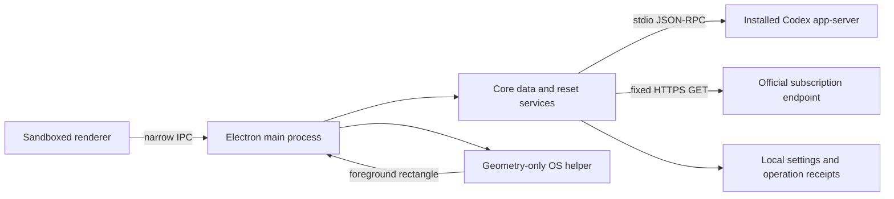

# Architecture / 架构

## Boundaries

- `shared/contracts.ts` specifies serializable UI state and the only exposed bridge methods. All timestamps are milliseconds since epoch; protocol seconds are converted in the parser.
- `core/auth.ts` reads supported ChatGPT credentials and checks account-claim consistency. Signature validation remains the official server's responsibility. Tokens are never exposed to the renderer or persisted by this project.
- `core/rpc.ts` starts the selected native Codex executable with argument arrays and `shell: false`. It initializes the experimental protocol, enforces a timeout, and terminates the child. Full-detail quota reads may fall back once to the legacy parameter format only after an explicit parameter rejection. Response account identity is checked before publishing. Reset requests never automatically retry.
- `core/reset.ts` selects a specific credit, checks account/expiry, persists a UUID before a confirmed request, and preserves it after uncertainty. It does not select a fallback credit. Partial lists or a `redeeming` status cannot clear an unresolved receipt.
- `core/storage.ts` atomically stores settings and account-scoped operation receipts. A corrupt store stops startup rather than discarding duplicate-prevention records.
- `core/subscription.ts` uses a fixed official HTTPS endpoint with redirects disabled. Main rechecks account identity after the request. Official dates take precedence; cached and manual reference dates are labelled. Subscription requests cannot block quota refresh and late account responses are discarded.
- `main/application.ts` coordinates refresh, confirmation, subscription cache, and UI state. `main/index.ts` owns windows, tray, bounded IPC, startup, positioning, and lifecycle cleanup.
- `renderer/` has no Node integration and no filesystem or network access. A sandboxed preload exposes explicit actions. Backend strings use text nodes; CSP disallows inline script and remote resources.
- `native/` reads foreground application metadata and window bounds only. Windows physical pixels are converted to DIP in the Electron bridge; macOS emits Quartz top-left coordinates.

## Reset sequence

1. User explicitly clicks one available credit.
2. Main validates the current account, fresh data, credit identity and idle state.
3. Native confirmation defaults to Cancel.
4. Only confirmation invokes `ResetManager.execute(..., true)`.
5. The durable operation ID is saved before RPC. Account identity is checked before the child launches and immediately before the mutation is sent.
6. Success marks the credit processed, then rereads limits. Unknown results retain the same ID; retry requires another explicit confirmation.

`preview` never opens the account file or CLI. `read-only` allows quota reads but blocks reset at both entry and transport binding. Tests inject local fake transports and temporary settings.

## Foreground following

The helper emits a rectangle or hidden state and a periodic heartbeat. The parent hides on missing geometry, process failure or watchdog expiry. Helper restarts use exponential backoff capped at 30 seconds; ten healthy seconds reset the delay. Wake/unlock and the position-restore action restart tracking with a cleared host.

On macOS, the helper also checks the exact overlay CGWindowID and owner PID in the window server's on-screen list. `main/platform/visibility.ts` uses this observation to repair disagreement with Electron's `isVisible()` by hiding and ordering the panel in again, at most once per second. It preserves full-screen/Spaces participation and never calls `focus()` or `show()`. An unrelated, closed or minimized Codex host always hides the overlay. Windows retains its focusable native window and nonactivating initial display.

No screenshots, window-title parsing, chat text or Accessibility APIs are used. The native regression test operates on a separate offline test panel and substitutes the Electron visible flag; it does not control the user's Codex or use account credentials.

The macOS onscreen flag alone is insufficient during Space animations: the compositor can translate the surface outside physical displays while Electron still reports the desired bounds. Native visibility requires full containment within a Codex/display intersection (2 px tolerance). Recovery reapplies the desired bounds even if cached bounds match. Main passes this native status only for the current tracker message; quota/UI renders cannot replay a previous failed observation.

If fresh native observations continue to confirm absence for five seconds, main recreates the panel and rebinds the tracker to its new CGWindowID. Application data, expanded state and settings remain in the existing application instance. A 30-second cooldown survives tracker resets. Background transitions or confirmed visibility clear the failure interval; UI-only renders cannot trigger recreation.

On macOS, `HostSelection` remembers the verified Codex PID, launch date and exact window ID when Codex is foreground. When this overlay's own parent process takes foreground, it revalidates that host and continues following it. An unrelated application or missing/hidden host clears the association. Settings opened without a prior host cannot create one. A separate test executes this production Swift selection policy with synthetic application and window observations, covering the tracking behavior that preview mode disables.

## External dependencies

- [Codex app-server protocol](https://learn.chatgpt.com/docs/app-server)
- [Electron BrowserWindow](https://www.electronjs.org/docs/latest/api/browser-window)
- [Windows DPI conversion](https://www.electronjs.org/docs/latest/api/screen)
- [electron-builder v26](https://www.electron.build/v26/docs/)

The account subscription endpoint is a best-effort integration, not a stable public API. CLI layout and experimental protocol changes must fail safely and surface a useful error, never drop an explicit reset ID or retry with a fresh operation ID automatically.
