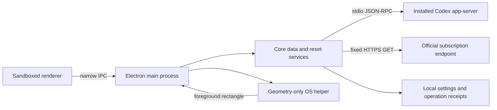

# Architecture / 架构

## Boundaries

- `shared/contracts.ts` specifies serializable UI state and the only exposed bridge methods. All timestamps are milliseconds since epoch; protocol seconds are converted in the parser.
- `core/auth.ts` reads supported ChatGPT credentials and checks account-claim consistency. Signature validation remains the official server's responsibility. Tokens are never exposed to the renderer or persisted by this project.
- `core/rpc.ts` starts the selected native Codex executable with argument arrays and `shell: false`. It initializes the experimental protocol, makes one request, enforces a timeout, and terminates the child. Read and reset requests cannot overlap.
- `core/reset.ts` selects a specific credit, checks account/expiry, persists a UUID before a confirmed request, and preserves it after uncertainty. It does not select a fallback credit. Partial lists or a `redeeming` status cannot clear an unresolved receipt.
- `core/storage.ts` atomically stores settings and account-scoped operation receipts. A corrupt store stops startup rather than discarding duplicate-prevention records.
- `core/subscription.ts` uses a fixed official HTTPS endpoint with redirects disabled. Main rechecks account identity after the request. Cached and manual dates are labelled.
- `main/application.ts` coordinates refresh, confirmation, subscription cache, and UI state. `main/index.ts` owns windows, tray, bounded IPC, startup, positioning, and lifecycle cleanup.
- `renderer/` has no Node integration and no filesystem or network access. A sandboxed preload exposes explicit actions. Backend strings use text nodes; CSP disallows inline script and remote resources.
- `native/` reads foreground application metadata and window bounds only. Windows physical pixels are converted to DIP in the Electron bridge; macOS emits Quartz top-left coordinates.

## Reset sequence

1. User explicitly clicks one available credit.
2. Main validates the current account, fresh data, credit identity and idle state.
3. Native confirmation defaults to Cancel.
4. Only confirmation invokes `ResetManager.execute(..., true)`.
5. The durable operation ID is saved before RPC. Account identity is checked before the child launches and immediately before the mutation is sent.
6. Success marks the credit processed, then rereads limits. Unknown results retain the same ID; retry requires another explicit confirmation.

`preview` never opens the account file or CLI. `read-only` allows quota reads but blocks reset at both entry and transport binding. Tests inject local fake transports and temporary settings.

## Foreground following

The helper emits a rectangle or hidden state and a periodic heartbeat. The parent hides on missing geometry, process failure or watchdog expiry. Restarts are bounded. The overlay is nonactivating, while Settings and the confirmation dialog can receive focus. No screenshots, window-title parsing, chat text or Accessibility APIs are used.

## External dependencies

- [Codex app-server protocol](https://learn.chatgpt.com/docs/app-server)
- [Electron BrowserWindow](https://www.electronjs.org/docs/latest/api/browser-window)
- [Windows DPI conversion](https://www.electronjs.org/docs/latest/api/screen)
- [electron-builder v26](https://www.electron.build/v26/docs/)

The account subscription endpoint is a best-effort integration, not a stable public API. CLI layout and experimental protocol changes must fail safely and surface a useful error, never drop an explicit reset ID or retry with a fresh operation ID automatically.
